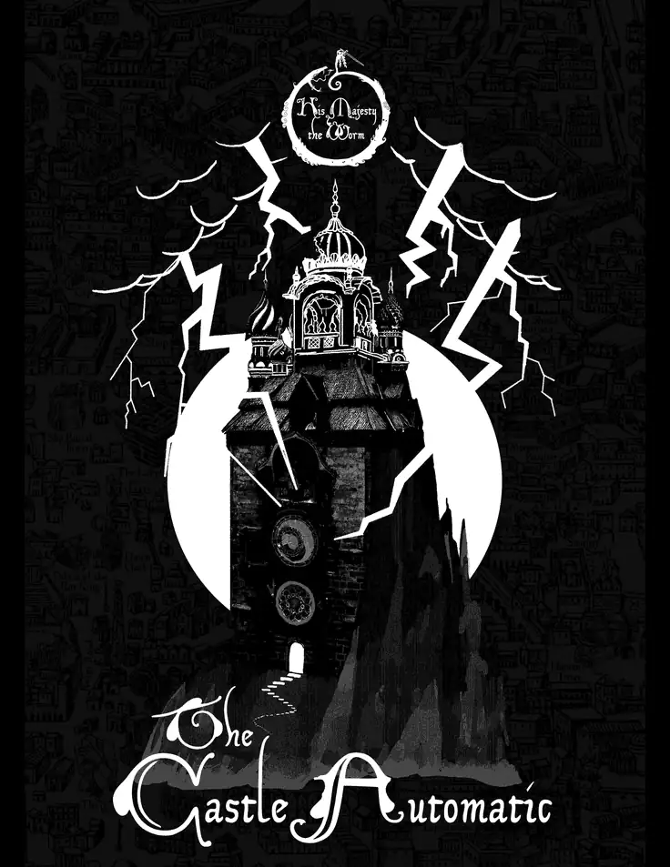
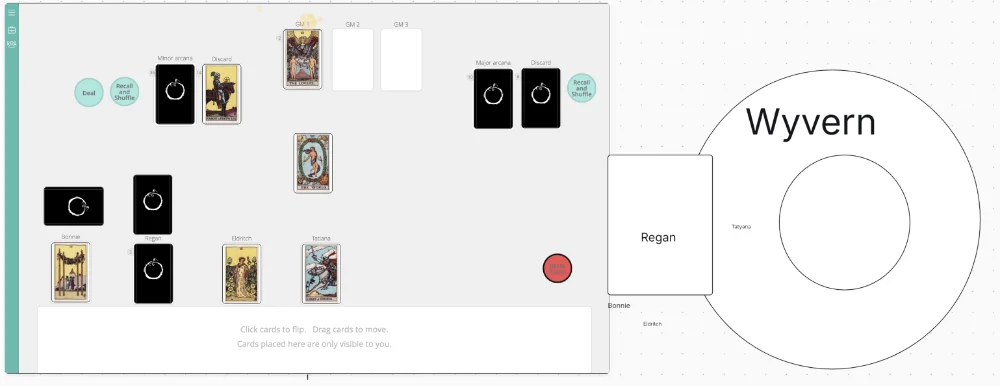

I was going to write up a short summary of the first session of our new [His Majesty the Worm](https://www.hismajestytheworm.games/) campaign set in the newly released dungeon—[The Castle Automatic](https://www.drivethrurpg.com/en/product/580710/the-castle-automatic-digital-edition?affiliate_id=1070389) both written by [Josh McCrowell](http://riseupcomus.blogspot.com/). I got a little carried away and figured I'd turn it into a hybrid session report/review/introduction.

This will have spoilers for the first part of The Castle Automatic so if you are a player who hasn't made it into the dungeon yet, maybe don't read it?

<figure>

<figcaption style="color: var(--gray); font-size: 0.85em; text-align: center;">The Castle Automatic Cover</figcaption>
</figure>

## The Cast

Regan of House Morwent. She should have been in line for the throne but the Tyrant Emperor who rules The City has dissolved the Senate, and so her position. Her quest is to recover the Perfect Sword which can Defeat any Weapon, she plans to use it to depose the Tyrant.

Eldritch Unending 961, a mopey dark elf pharmaceutical enthusiast on a quest to disappoint his parents and acquire the Wand of Power. Its ability to fold space will prove he has what it takes to be a sorcerer without all that boring hard work.

Tatyana Svetardaughter, a fireblooded orc on a quest to obtain blood from the Vampire lord, The Hierophant. She will use it in a ritual to contact the orcish god, Rng.

Bonnie Hatmaker, a halfling experimental-milliner, on a quest to consult the famed Dwarven genius inventor Taitale Allcraft and get her thoughts on hat design.

### The World

We started by finishing off the last bits of character creation, finalising inventory and the like then proceeded into the dungeon, first passing through the Ossuary, down into the underworld. What is the Ossuary, you ask?

His Majesty the Worm uses a method it calls "reverse archaeology" to generate the City where your game takes place. Most are generated randomly but a few, including the Ossuary—the way you access the underworld—and the Omphalic Market—where adventuring supplies are to be had—are always present.

We ended up with thirteen districts the players can visit when they need a break from the dungeon. They range from a Hippodrome where you can buy exotic animals, to a language school, an Alchemist's Quarter, with a thief's hideout above—clinging there on the shattered masonry blasted into the air and suspended by an alchemical miscalculation—and a market square where cracks in the earth vent hallucinogenic fumes that inspire prophecy. The City is ruled by the Tyrant Emperor, though the wise do not use that name.

The districts described in the book are two or three paragraphs of flavour and a unique city action. They have enough to spark your imagination without overwhelming you with details to memorise.

I love this sort of minimal worldbuilding, I have [[Rolling for Inspiration|blogged before]] about taking minimal prompts as inspiration to build something unique.

We did a little collaborative worldbuilding when we drew them, the Gambol is always a rooftop district for example, we added the detail of the floating masonry because it was located above the Alchemist's Quarter.

## Prelude

We passed through the Ossuary, the entrance to the underworld cared for by the sisters of the Silent Order. They wear elaborate veiled headdresses topped with the skull of the previous holder of their station. Their rank can be determined by the height of this elaborate headgear.

In the Ossuary is the Ivory Gate, the entrance to the underworld proper. When it was opened monsters poured through into the city. It was opened deliberately by the vile House Vulpin, one of the friezes on the door shows their vicious dingos tearing at the throats of the noble rhinoceros that are the sign of House Morwent. Their enmity is ancient.

The monsters were quelled by the man who would become His Serenity the Emperor with the aid of his All-watch. The All-watch stand guard here still—their black armour topped with a helm showing His Serenity's sigil, a lidless red eye watching benevolently over his people—their armour is dripping with jewellery an outward demonstration of the wealth lavished upon them, no bribe could outweigh the rewards they already receive.

The watch took down the guild's (party's) name, The Orphans of Orpheus. They reminded them all coin recovered from the underworld is taxed at the moderate rate of 50%. They also issued a reminder that fallen companions should not be left in the underworld, lest they get back up and walk around as corpses there are wont to do.

In the underworld proper Regan took out the map, a gift from an anonymous patriot, that showed the Castle Automatic on one side and had directions to the entrance on the reverse.

They came to a tunnel with the remains of spiderweb, no ordinary spider had spun these. The strands are as thick as fingers, the long tunnel would have taken strong men with axes days to clear but they had been brushed aside as easily as you might brush aside an ordinary cobweb. Impressions left in the stone tell the tale. Only His Majesty the Worm himself could have left such marks, the impressions of his mighty scales in the rock like you might leave footprints in mud.

The passage opened into strangeness, a wall it took a second to recognise in this context. The same construction as the City wall. It held a gate whose disappearance has long been a mystery. The famed Victory Gate of the ancient Emperor of the Wide World, the very one who had commissioned the Castle Automatic as the storehouse of his treasures, locking its creator Taitale inside to prevent its secrets becoming known.

His likeness is carved above the gate in bas-relief. Towering over everyone, hammering on their heads while they bring tribute. His toothy crown is characteristic—we still use toothy crowns today. Four bells hang from his belt, and they sound your doom. The gate itself, hammered from a white metal gained in one of his victories. Obvious giant-work, the hammer marks as big around as your head show a strength no human could match.

The gate itself stands open, the air inside a shimmering curtain. Stepping through it led to the Castle Automatic itself.

*There was a good mixture here of the basic detail supplied by the book, the Ossuary, the Silent Order, the entrance to the Castle Automatic having been opened by His Majesty the Worm, but there was lots of space for us to fill in the detail. The headdresses, gates, guards, crown details and more all from the players' imagination.*

## The Castle Automatic

The room they appeared in is an indoor garden, a statue of the Emperor of the World shown with his raised foot on a globe dominates the room, doves flit around it and a broken statue lies at its feet. On the walls are four mirrors, their clouded surfaces showing indistinct reflections. The map indicates that perhaps they are doors but the mechanism to activate them is not obvious. Opposite the grand triumphal arch they entered through is a smaller door leading to a staircase.

The staircase windows show a twilight scene, not the black of an underground cave, in fact pinprick points of starlight can be seen above. A mystery—by the hour if it were outdoors the sun should be shining, if still underground pitch-black.

The stairs lead both up and down, the party headed upwards.

Another circular chamber, this one with an ornate domed roof decorated with the image of the sun.

Much of the floor is filled with machinery, a large coil in the shape of a dragon with an attached wheel like one you might use to steer a ship, unable to be moved. The coil itself inscribed with a riddle, or perhaps an instruction? Only Eldritch can read it, Vetus is the script of the only written language and the others do not speak it.

> "After storm and wyvern's ire, the sun will light with smokeless fire."

Wasn't one of the rumours the party had collected something about there being a wyvern in the castle? or was it a dragon? What is the difference again?

Our alchemist searched his memory, recalling a book he had read as a child, the story was fictional but supposedly based in truth and the wyvern it featured breathed lightning. Could it be that simple? Assuming of course the wyvern could be persuaded to breathe on the thing.

They also spotted a lever in the shape of a crawfish with a prominent keyhole. Our nimble-fingered orc muttered a prayer to Rng before trying her lockpicks. This sort of check is called a [[#The Crawl Phase|Test of Fate]] in HMtW.

Rng smiled and the lock clicked open. Pulling the lever caused the roof to begin to slide open. The mechanisms still worked! Tatyana praised Rng, Bonnie thought it more likely a sign of Taitale's genius.

*I was a little wary of letting them bypass the lock like this, should I have made them explore for the key? The Castle Automatic book handily provides the answer, puzzles should have multiple solutions. Let them pick the lock.*

As the roof was half-way open, they heard a sound from outside something flapping in the wind, a large sheet shaken out? No, it sounds like something heavier, a sheet of leather? Oh shit, it's the flapping wings of the wyvern.

They tested their fate as a group this time as they fled for the staircase. Rng smiled on them again and the hostile wyvern did not make it into position to attack before they were out of range.

Gathering their breath in the stairwell Regan showed the daring that may have caused someone to give her the map. She would make her way back up, stand in front of the mechanism and taunt the wyvern—leaping aside before its breath electrocuted her.

Tatyana refused to let her rival take all the glory and insisted on accompanying her while the others hid in the alcove. Sorry, sensibly took cover and waited for an opportunity to aid them.

The scene of the [[#The Challenge Phase|challenge]] set, the drama began. Regan dashed to the mechanism, while Tatyana, attached to her by a chain to help her back in if incapacitated (that isn't a metal chain, right?) waited nearby.

The wyvern approached, Regan used her skill at banter to taunt it into an attack and the wyvern struck. It did indeed breathe lightning but between Tatyana helping her dodge by yanking the chain that attached them and Regan getting her shield up at the last second the lightning did indeed miss her and struck the coil.

It started to glow brightly, thrumming with energy. They raised a cheer, victory! However, they still had an angry wyvern to deal with and it had other weapons than its breath.

The two in the stairway dashed downward as the mission was accomplished and they saw no reason to take more risks. Two brave heroes (fools?) fled for the door to follow them. As they did, the wyvern beat its great wings forcing them to choose between being knocked prone or displaced back into the centre of the room.

They both chose to be knocked flat and the wyvern struck again, lashing with its great tail and leaving them staggered. Tatyana shoved Regan towards the doorway as the wyvern looked ready to pounce again.

That was where we left our first session.

## The Mechanics

His Majesty the Worm uses Tarot cards to generate random results. The players draw from the minor arcana plus the Fool. 4 suits with values of 1-10 plus the four face cards to generate numbers between 1-14. The Fool has a value of 0, triggers reshuffling the decks and is either good or bad depending on when it is drawn. The GM draws from the major arcana—the traditional picture cards you will have heard of even if you don't know tarot—Death, The Hanged Man etc. They give values from 1-21.

Players and monsters have 4 attributes. Swords (strength), Pentacles (dexterity), Cups (wisdom and learning) and Wands (willpower and charisma). They decide on their scores by assigning each of them 1-4, the one with a 4 is their Path (class) and determines what talents they can use.

The game is split into four phases, which as I just realised match the four suits. The writing here really is impressive. At first, I thought the tarot was set dressing and a cool randomiser but it really does run all through the game. The character paths, the four phases, the magic system lots of fours and lots of matching to the suits.

This session, we experienced the Crawl Phase—exploration, and Challenge Phase—combat or similar second-by-second activity.

We still look forwards to the Camp Phase where you use your relationships with the rest of the party to recover and the City Phase where you can indulge your downtime activity.

### The Crawl Phase

<figure>

<figcaption style="color: var(--gray); font-size: 0.85em; text-align: center;">Our VTT showing the crawl phase in progress</figcaption>
</figure>

The game says that you should give players the dungeon map (less any secrets of course). This is a great way to run dungeons. No messing with dynamic lighting or correcting player drawn maps at the table, no confusion about what is where.

The GM has a "Meatgrinder Table" they draw from every "watch". A watch being the game's time unit in the underworld. It is the time taken to move from room to room, but a watch also passes if the guild spend a long time somewhere doing an activity, or if they take the time to camp. It is a 1-21 table that has a 5/21 chance of four different outcomes.

- **Torches Gutter.** Time passes and the party's light resources are depleted.
- **Curiosities.** "Nothing happens" but in a way that adds clues or flavour to the dungeon.
- **Travel Events.** Something goes wrong and the party have a choice to make or problem to solve.
- **Random Encounters.** Not all are hostile, but if you are going to get jumped by zombies this is the result that will do it.

The final result, on a 21, is a **quest rumour**. Something specific to the Guild's current goal.

The events are marked off as they happen and are restocked by the GM during the City phase. A nice touch, no repeatedly drawing 2d4 goblins, and the restock allows the opportunity to make the dungeon your own. For example, a few things came up in our first session that would be difficult to implement in a pre-written dungeon. As they do I can note them down, then add them to the meatgrinder when I restock it.

The crawl phase has a mechanism for skill/ability checks known as Tests of Fate.

The player draws a card, adds a relevant attribute (from 1-4), if they have favour—from a relevant motif (background), spending a resource, or carefully setting up the situation—they can add another 3. Disfavour, usually situational, subtracts 3.

If they get 14+ they succeed, if they fail, they may push fate and draw another card, if this gets them to 14 that's a success but if they fail after pushing then it is a great failure and something bad happens. If they succeed with a single card that matches the ability they are adding then that is a great success and they get something extra.

Group checks are done by the most and least capable both testing fate. If both succeed or one fails and the other gets a great success then they succeed, lesser results can be partial successes, failures or disasters. I preferred this to the everyone-rolls approach some systems use.

### The Challenge Phase

<figure>

<figcaption style="color: var(--gray); font-size: 0.85em; text-align: center;">The Challenge Phase as they faced the wyvern</figcaption>
</figure>

For combat, or similar challenges all the players and the GM draw a hand of cards and then you play a sort of hybrid of bridge, poker and Pokémon to determine the outcome.

We have not yet mastered this, not helped by the players deciding to confront a pretty complicated monster and instead of fighting it having an aim of getting it do something then escaping. It says something positive about the system that we made it work though; the system was more capable of it than we were. We were getting the hang of it by the end of the session and I think mastering it will be well worth the effort.

I won't describe it in great detail but the highlights are that you play a facedown card that acts as both your initiative and defence value, you can be quick and easy to hit or slow and harder to hit.

Play proceeds in turns by initiative. On your turn, you have more options and are more effective, but after you take your turn everyone else gets to act as well.

I like that the card choices make for tactical choices without needing detailed gridded maps (HMtW uses zones for challenges). You don't have to wait forever for your turn as you can act off-turn and there are no wasted turns where you roll to hit, miss and pass to the next player then look at your phone until you get to try again. You know what is in your hand and generally have an idea of your opponent's defence value. Even if you attack and "miss" early in the round you still did something useful by revealing your opponent's card. If you have no cards that would let you beat an opponent's defence you can use items, move, help others and more.

## First Impression and Feedback

This was our third session of "proper" play. Before deciding on a HMtW campaign we had played two sessions in the starter dungeon and decided we liked it enough to do more. We had a chill session building the city and last week a session 0 to make characters and do all the other session 0 stuff.

The game is great. Characters are rich (in texture, not in gold) right from the start as you generate them by making choices about failed careers and childhood struggles before finding your path. Your Guild are tied together by a system of bonds that gets the roleplay going right away.

The bare-bones setting gives you enough to spark your imagination so you can riff off it to make it your own. I don't know if that is for everyone but we have been enjoying [[What I Talk About When I Talk About Daggerheart|Daggerheart]] a lot and I'm using the ideas from there to have players flesh out the world in all my games now.

The card-based randomisation is good, being able to alternate between getting a random value in a test of fate and hold a hand of cards in a challenge is not feasible with dice. The fact that your randomisation has a memory and you can use values from the discard pile is a nice bonus.

The writing in [His Majesty the Worm](https://www.drivethrurpg.com/en/product/488062/his-majesty-the-worm-digital-edition?affiliate_id=1070389) is fantastic, the organisation could use a little work, but the index is good. The fact that the author grants a generous reuse permission means tools like Arrowed's [Guild Book](https://guildbook.arrowed.games/) or my [rules reference](https://splatbook.app/hmtw) are possible if you want a good search option.

The Castle Automatic dungeon seems pretty great. We haven't got far but there are fantastic NPCs, lots of mechanisms to play with and a great backstory. If you buy it online the book also comes with an art pack with all the book art included along with page numbers, it makes showing the players the art very smooth. More of Josh working hard to make me look like a great GM.

The player feedback was good. Two of four players called out the system as a star, one called out the mechanical devices to play with in the Castle and the other called out the characters and handouts. The handout being largely cribbed from the book (can't help but love a book that makes the GM look good). Wishes were generally for more of the same.

I doubt I'll post such a full write-up every session, but I will make sure to come back and cover it when we do a Camp and City phase.
